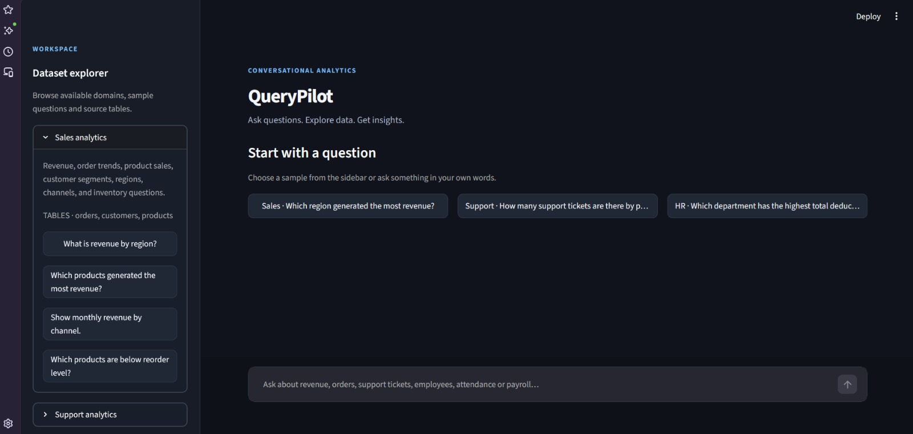
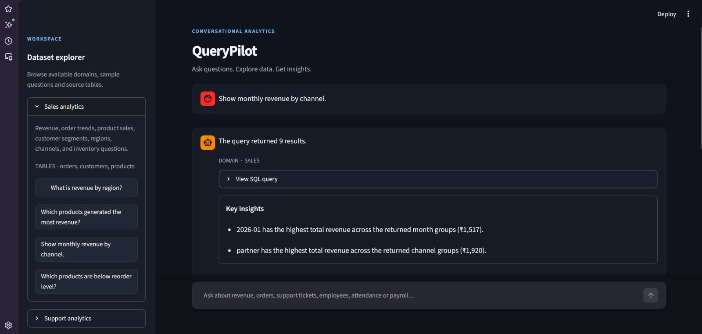
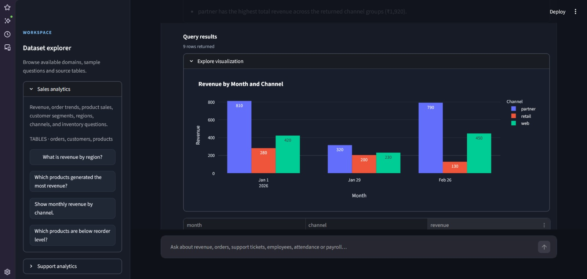

# QueryPilot

**Ask questions about business data in plain English and explore the results.**

QueryPilot is a local, multi-domain analytics assistant that translates natural-language questions into read-only SQL, executes them against a SQLite dataset, and presents the results with concise, data-grounded insights and visualizations.

## What it does

- **Natural-language analytics:** ask questions without writing SQL manually.
- **Domain-aware routing:** directs questions to the relevant data area:
  - **Sales:** orders, customers, products, revenue, channels, and inventory.
  - **Customer Support:** ticket volume, priorities, statuses, categories, and resolution times.
  - **HR:** employee records, attendance, leave applications, and payroll.
- **Follow-up questions:** uses conversation context to interpret follow-up queries.
- **SQL safeguards:** validates generated queries as read-only and restricts table access to the selected domain.
- **Result exploration:** displays the generated SQL, result tables, concise insights, and suggested charts.
- **Local execution:** loads CSV files into an in-memory SQLite database; no hosted database is required.

## How the workflow operates

1. The question is rewritten when conversation context is needed.
2. The request is routed to a data domain.
3. The language model generates SQL using the selected domain's schema.
4. The SQL validator checks the query before execution.
5. The query runs against the local SQLite database.
6. Query results are rendered in the Streamlit interface, with deterministic insights derived from the returned rows and a chart suggestion where appropriate.

## Technology

- Python
- Streamlit
- LangChain
- LangGraph
- Ollama
- SQLite
- Pandas
- Plotly
- SQLGlot

## Project structure

```text
QueryPilot/
├── agent.py             # LangGraph workflow and NL-to-SQL agent
├── app.py               # Streamlit application and result presentation
├── config.py            # Domain definitions and example questions
├── dataset.py           # CSV loading and SQLite data access
├── main.py              # Optional terminal interface
├── sql_safety.py        # Read-only SQL validation
├── visualization.py     # Result-shape-based chart suggestions
├── data/
│   ├── customers.csv
│   ├── orders.csv
│   ├── products.csv
│   ├── support_tickets.csv
│   ├── employees.csv
│   ├── attendance.csv
│   ├── leaves.csv
│   └── payroll.csv
├── env.example
├── .gitignore
└── pyproject.toml
```

## Requirements

- Python 3.10 or newer
- [Ollama](https://ollama.com/) installed and running locally
- A model pulled into Ollama (the default is `gemma3:4b`)

Pull the default model:

```bash
ollama pull gemma3:4b
```

You can use another locally available Ollama model by changing `OLLAMA_MODEL`.

## Setup

Create and activate a virtual environment.

**Windows PowerShell**
```powershell
python -m venv .venv
.venv\Scripts\Activate.ps1
```

**macOS / Linux**
```bash
python -m venv .venv
source .venv/bin/activate
```

Install the project dependencies:

```bash
pip install -e .
```

Create a local environment file:

**Windows PowerShell**
```powershell
Copy-Item env.example .env
```

**macOS / Linux**
```bash
cp env.example .env
```

The default configuration uses `gemma3:4b`. Edit `.env` only if you want to select a different Ollama model:

```env
OLLAMA_MODEL=gemma3:4b
```

## Run QueryPilot

Start the Streamlit interface:

```bash
streamlit run app.py
```

The app opens in your browser. Choose a domain or try one of the suggested questions.

An optional terminal interface is also available:

```bash
python main.py
```

## Example questions

**Sales**
- What is revenue by region?
- Which products generated the most revenue?
- Show monthly revenue by channel.
- Which products are below reorder level?

**Customer Support**
- How many open support tickets are there by priority?
- What is the average resolution time by ticket category?
- Which customer segments have the most urgent tickets?
- Show support tickets by status.

**HR**
- How many employees are there in each department?
- Which department has the highest absenteeism?
- Show monthly attendance percentage by department.
- Which employees have taken the most approved leaves?
- Calculate gross and net payroll by department and month.
- Which department has the highest total deductions?

## Dataset notes

The included CSV files are demonstration data. The HR records are synthetic and fictional. Payroll amounts are illustrative INR values and are **not** statutory payroll calculations or advice. Attendance data covers scheduled weekdays in the included sample period. Do not treat the sample records as real employee or business information.

The database is rebuilt in memory from the CSV files when the application starts. Changes made directly to the in-memory database do not persist after the app exits.

## Current scope and limitations

- The application is designed for local demonstration and experimentation, not production deployment.
- SQL is restricted to read-only queries and the tables permitted for the selected domain.
- Data is limited to the CSV files included in this repository.
- Query quality depends on the selected local language model and the clarity of the question.
- The application does not currently provide authentication, role-based access, multi-user isolation, or a persistent production database.

## Application Preview

### Main Dashboard


### Query Results and Insights


### Data Visualization
